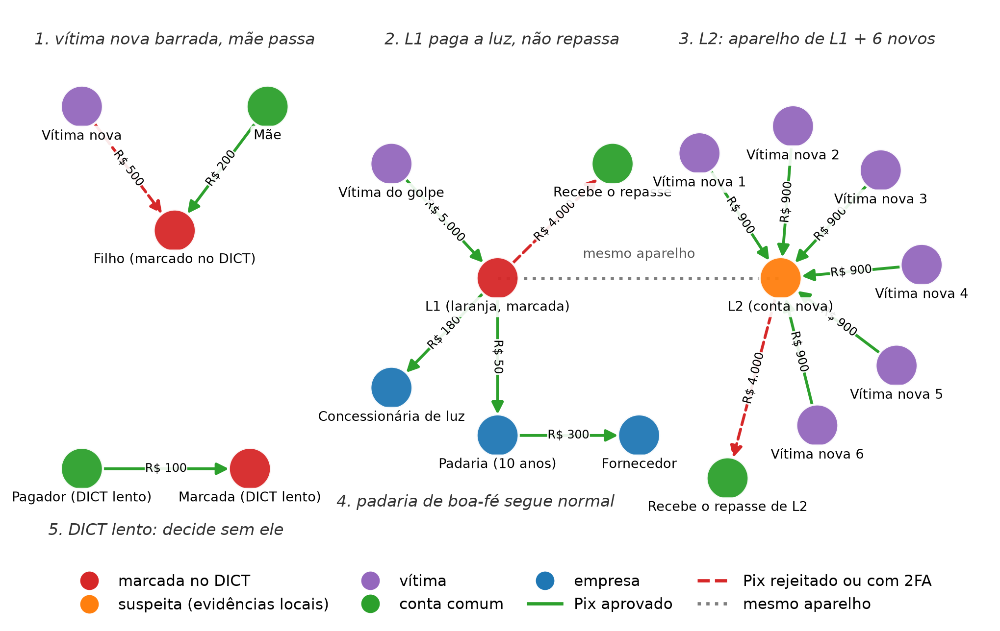

# Motor Antifraude Pix

**Integrantes:** Renan Correia e Luigi Nakata

## Como o motor de decisão funciona

API antifraude Pix baseada no Base Service, com FastAPI e PostgreSQL. O `POST /pix/transaction` valida o pedido, consulta o histórico e o DICT simulado, aplica as regras e grava a decisão. O `GET /pix/transaction/{id}` devolve a análise original.

A resposta contém `key`, `status` e `metadata`, com um único motivo. Os resultados possíveis são `approved`, `two_factor_required` e `rejected`. A trava por conta pagadora impede que solicitações simultâneas ultrapassem juntas os limites. As regras ficam separadas do acesso ao banco e às fontes externas.

## Regras

Política atual: **`pix-v1.3`**, na branch **`v3`**. Os valores chegam em centavos. As janelas usam `transaction_date` e o intervalo `(t − janela, t]`. Os parâmetros são escolhas iniciais do protótipo, sem calibração em dados reais.

| Regra | Lógica | Parâmetros | Por quê |
| --- | --- | --- | --- |
| R1 — conta nova | Rejeitar quando o acumulado aprovado + Pix atual ultrapassar o teto inicial | Conta com menos de 7 dias; R$ 1.000 em 24h | Conter a exposição na primeira semana e impedir contorno por fracionamento |
| R2 — teto geral | Rejeitar quando o acumulado aprovado + atual ultrapassar o teto geral | R$ 20.000 em 24h | Limitar a exposição e permitir que R5 solicite 2FA antes do teto, sem depender de renda ou saldo ausentes do contrato |
| R3 — frequência | Pedir 2FA na terceira tentativa distinta ou posterior | 3 solicitações em 2 minutos | Tolerar duas operações próximas e exigir confirmação em uma rajada |
| R4 — aparelho e valor | Pedir 2FA em valor alto sem aparelho familiar | Pix ≥ R$ 5.000; familiaridade após 24h da primeira aprovação naquele aparelho e conta | Combinar exposição relevante e falta de histórico; uma aprovação pequena não libera valores altos imediatamente |
| R5 — desvio da média | Pedir 2FA quando o Pix superar 10 vezes a referência da conta | Referência = **maior entre média aprovada e R$ 500**; exige aprovação anterior; comparação estrita | Identificar desvio em aparelho conhecido, sem desativar a regra quando pagamentos pequenos reduzem a média |
| L1 — destino | Rejeitar destino em suspeita elevada sem relacionamento anterior às evidências | Classificação abaixo; aprovação prévia para o mesmo titular antes do início conhecido da evidência | Proteger novos pagadores, mantendo uma exceção limitada para relacionamentos anteriores |
| L2 — pagador | Rejeitar pagador em suspeita elevada quando o ato não for gasto típico | Inclui repasse aparente e outros atos | Restringir saídas de maior risco, preservando pagamentos cotidianos limitados |
| L3 — repasse | Rejeitar conta suspeita que realiza repasse aparente | Classificação e ato definidos abaixo | Combinar sinais da conta e movimentação, sem recusar todo pagamento da conta suspeita |

Somente aprovações consomem os tetos e alimentam os fluxos e vínculos. R3 conta os três resultados, sem contar reenvios ou entradas inválidas. Os limites são por conta pagadora; valores exatamente no teto de R1/R2 passam.

R5 calcula a média de **todos os Pix enviados e aprovados observados até `transaction_date`**, sem incluir o atual, recebimentos ou reenvios. Não é uma média diária. Sem aprovação anterior, R5 não atua. Com média de R$ 600, o limiar de 2FA é R$ 6.000; se a média cair para R$ 300,50, a referência fica em R$ 500 e o limiar em R$ 5.000. Igualdade não aciona R5. Esses valores são limiares de confirmação; o teto de rejeição continua em R$ 20.000 acumulados em 24h. O cálculo usa soma e quantidade sem arredondar a média.

### Classificação de possível laranja

| Evidência | Lógica | Parâmetros | Por quê |
| --- | --- | --- | --- |
| E1 | Marcação de laranja/golpista ou relatos de instituições distintas no mock | Janela de 90 dias; ≥ 1 marcação ou ≥ 2 instituições | Usar sinais externos sem tratar relato único como confirmação; fontes podem refletir o mesmo fato |
| E2 | Maioria do recebido vem de contas E1, ou há aparelho compartilhado com conta E1 | Mais de 50% em 30 dias; usos anteriores aprovados das duas contas no aparelho; conta com menos de 90 dias **ou** menos de 10 contrapartes em 30 dias | Proporção e reputação reduzem associações por recebimentos ocasionais; só E1 propaga, por um salto |
| E3 | Concentração de titulares remetentes com estreantes | Em 1h: ≥ 5 titulares para PF ou ≥ 30 para CNPJ; ≥ 3 estreantes | Buscar concentração recente, com maior tolerância para recebimentos comerciais |
| E4 | Relatos de infração ainda abertos no mock | ≥ 2 relatos | Dar peso à recorrência, combinada com vínculo local |
| E5 | Conta recente recebe volume de vários titulares | Menos de 7 dias; mais de R$ 5.000 em 24h; ≥ 3 titulares | Combinar novidade, volume e diversidade; o valor equivale a cinco vezes o teto inicial de saída |

E2 conta contrapartes por conta; E3/E5 contam titulares. **Suspeita elevada:** E1 ou E2+E4. **Suspeita:** outras combinações positivas, inclusive E3+E5. **`nao`:** nenhuma evidência positiva disponível. E3+E5 não eleva o estado porque pode representar a mesma arrecadação legítima. Informação indisponível permanece desconhecida.

### Tipo de pagamento

1. **Repasse aparente:** recebeu pelo menos R$ 1.000 aprovados em 1h e as saídas aprovadas + atual atingem 50% ou mais desse valor, para PF ou CNPJ cuja conta tem menos de 90 dias. O mínimo evita inferir repasse de entradas pequenas; a proporção busca saída de parcela relevante.
2. **Gasto típico:** fora do repasse, até R$ 1.000 para titular já conhecido por aprovação anterior ou CNPJ com conta de pelo menos 90 dias. É uma exceção limitada; idade não comprova legitimidade.
3. **Outro:** demais casos. L2 também os rejeita, aceitando essa fricção como custo do protótipo.

Repasse prevalece mesmo para destinatário conhecido. Relacionamento anterior exige início explícito da evidência; se desconhecido, inclusive em E2+E4, a exceção não é presumida.

## Como as regras viram decisão

**R1 → R2 → L1 → L2 → L3 → R4 → R3 → R5 → aprovação.** A primeira condição aplicável determina o resultado e o único motivo em `metadata.reason`, com os valores que o explicam.

Rejeições precedem 2FA. O módulo de laranja não pede segundo fator: o próprio operador pode confirmá-lo. `two_factor_required` não consome limite nem cria familiaridade; a conclusão do 2FA fica fora desta API.

O DICT é um **mock**: consultas em paralelo, prazo de 200 ms, antes da trava. O pagador usa cache de **5 minutos desde a consulta**, sem renovar na leitura; a primeira análise após expirar consulta novamente. O destino continua ao vivo, com reserva de cache de 1h. Falha sem cache válido deixa E1/E4 desconhecidas e a política continua com os sinais disponíveis.

O histórico cobre apenas análises observadas, não liquidação. Cache pode atrasar marcações; autenticação válida, relação anterior ou CNPJ antigo não garantem pagamento legítimo. Sem liquidação, cadastro ou fonte externa real, esta versão é um protótipo de decisão.

## Como rodar e testar

Com Docker Desktop e Docker Compose, na raiz do projeto:

```bash
docker compose up --build -d --wait
docker compose --profile test run --build --rm tests
docker compose --profile test run --rm --no-deps tests python -m flake8 .
```

Não é necessário Python no host nem criar `.env`. A API atende em `http://localhost:3000`; as rotas Pix exigem `INTERNAL-TOKEN: default_token`. O banco e o DICT simulado ficam só dentro da rede do compose, sem publicar portas no host, então um Postgres local na 5432 não atrapalha. Se a 3000 estiver ocupada, ponha `API_PORT=3001` num `.env` (modelo em [.env.example](.env.example)). O formato do pedido está no [schema](src/schemas/post_pix_transaction.json).

**Banco de uma versão anterior:** antes de usar a nova política, reconstrua o serviço `db` e aplique a [migração](database/migrations/001_account_average_reason.sql). Ela libera o novo motivo sem apagar nem reavaliar análises antigas:

```bash
docker compose up --build -d --wait db
docker compose exec -T db psql -U bootcamp -d bootcamp -v ON_ERROR_STOP=1 -f /migrations/001_account_average_reason.sql
docker compose up --build -d --wait
```

A suíte teve **262 testes aprovados**, cobrindo contrato, decisões e fricção das regras, média histórica, cenários de laranja, idempotência, concorrência e recuperação de falhas. O documento de [testes e validação](docs/testes-e-validacao-v2.md) mostra o que cada arquivo cobre e o que a suíte não prova. O GET preserva a resposta original; reenvio equivalente retorna 200, conflito de ID retorna 409. Entrada fora do formato retorna 400; datas não suportadas, identidade ou ordem incoerente e Pix para a mesma conta retornam 422. Contas distintas do mesmo titular continuam permitidas. Falha técnica retorna erro, sem virar decisão antifraude.

Para executar a demo e gerar o grafo:

```bash
docker compose --profile test run --rm --no-deps -v ./output/demo:/app/output/demo tests python scripts/seed_demo.py
docker compose --profile test run --rm --no-deps -v ./output/demo:/app/output/demo tests python scripts/graph_demo.py
```

A demo verifica sete decisões com dados fictícios e desenha o grafo em `output/demo/grafo-demo-v2.png`:



## Documentação

| Documento | O que contém |
| --- | --- |
| [Política antifraude](docs/politica-antifraude-v2.md) | Todas as regras da `pix-v1.3` num só lugar: definições, R1–R5, evidências E1–E5, ato, L1–L3, ordem, cenários C01–C21 e P01–P20, riscos, alternativas descartadas e histórico de versões |
| [Arquitetura e dados](docs/arquitetura-e-dados-v2.md) ([PDF](output/pdf/arquitetura-e-dados-v2.pdf)) | Contrato e respostas HTTP, modelo de dados, histórico que o motor lê, DICT e cache, fluxos do POST e da decisão, trava e idempotência, camadas |
| [Testes e validação](docs/testes-e-validacao-v2.md) | Estratégia black box, exceções, o que cada arquivo cobre, resultados e limites |

Os documentos das versões anteriores (política v1, módulo e guia v1.1, revisões v1.2 e v1.3, revisão dos testes) ficam preservados em [docs/historico/](docs/historico/).
