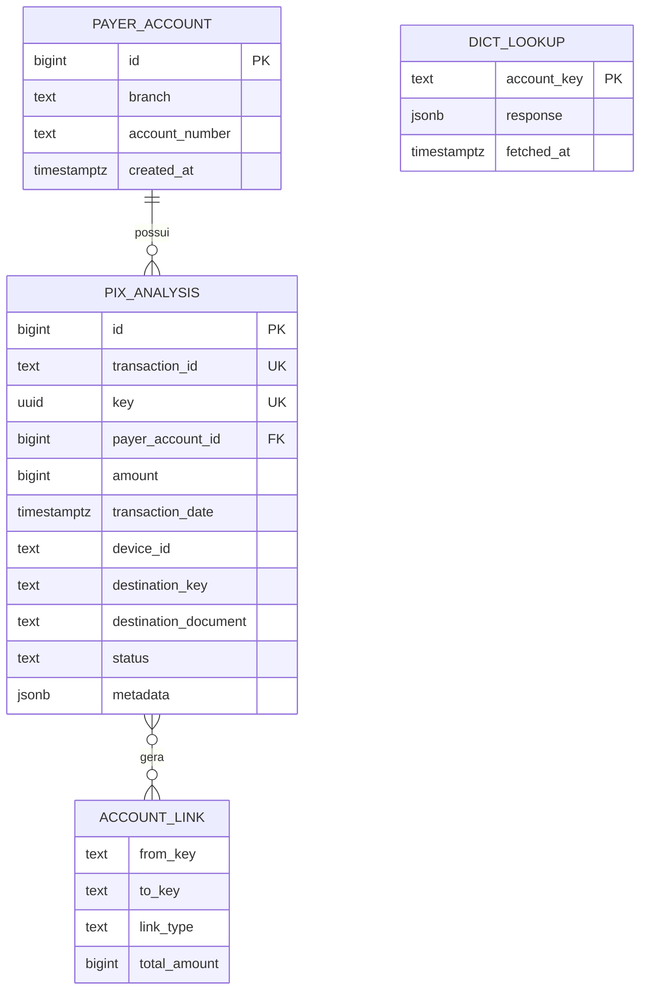
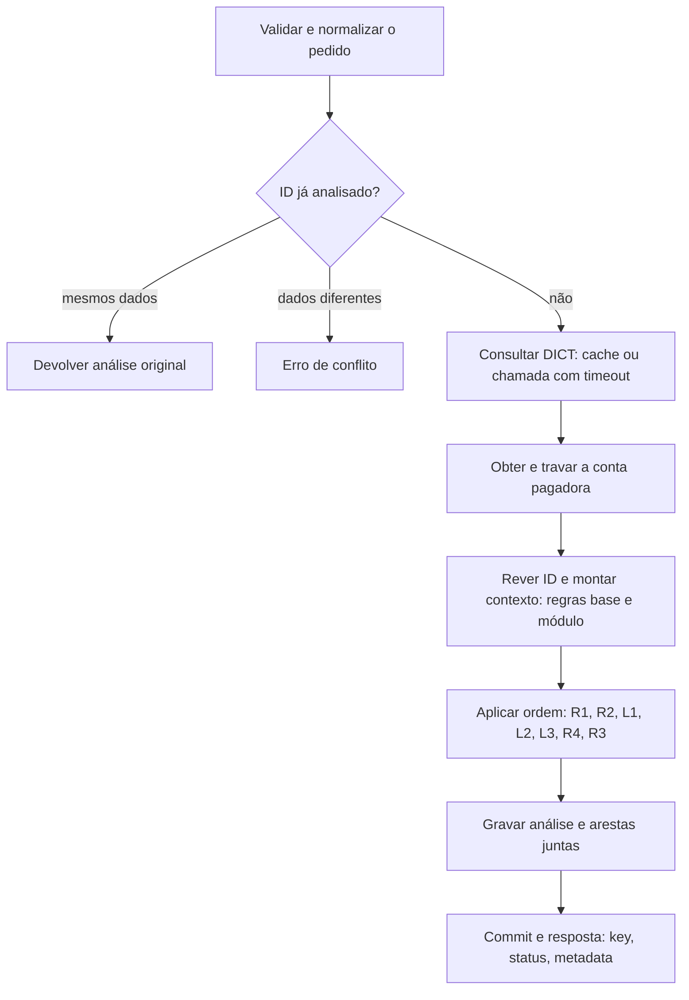

# Motor Antifraude Pix — Guia de desenvolvimento

Oct 17, 2026 · @renan

## Contexto e objetivo

Vamos entregar uma API que decide cada Pix em milissegundos como `approved`, `two_factor_required` ou `rejected`, sempre com um motivo nomeado. O link do repositório vai no grupo da final no Slack até domingo, 18/10, às 12h.

O motor responde a três restrições do problema, e cada decisão deste guia sai delas:

- **Tempo.** A decisão sai antes do dinheiro, em poucos segundos. Nada de consulta externa pesada nem de analista no caminho.
- **Histórico.** Um Pix sozinho diz pouco. Toda regra forte compara com o que esse pagador e esse destino já fizeram.
- **Fricção.** Bloquear cliente bom também é prejuízo. O 2FA só aparece onde há dúvida real; quem paga o aluguel todo mês passa direto.

Como a banca corrige, em ordem de peso:

| Critério | O que eles olham | Onde este guia responde |
| --- | --- | --- |
| Profundidade antifraude | regras calibradas, sem parar no óbvio | Regras base; Módulo de conta laranja; Grafo de contas |
| Padrão de código | camadas do Base Service, testes bem elaborados | Fluxo do POST; Testes e demo |
| Modelagem de dados | estrutura do banco | Modelo de dados |
| Solução funcional | roda pelo README, todo Pix gravado e consultável, decisão bate com as regras | Contrato da API; Ordem de decisão |
| Documentação | README no modelo deles | Plano de implementação |
| Apresentação | 7 min + 3 de perguntas, raciocínio por trás das decisões | Testes e demo; Riscos e alternativas |

A correção começa pelo README: cada parâmetro precisa de um "por quê" escrito. Regra sem justificativa conta como regra que não existe.

## Fontes deste guia

Este guia junta três documentos do time num desenho único. Quando um deles decide algo, o guia segue; quando diverge, a seção Convenções e pendências registra.

| Documento | O que define | Status |
| --- | --- | --- |
| `regras-de-negocio.md` (política acordada) | regras base R1 a R4, definições, ordem, motivo único, cenários C01 a C21 | acordada pelo time |
| `dados-e-fluxo.md` | modelo de dados, indicadores, fluxo do POST, trava por conta, idempotência, GET | proposta técnica v0.1, a revisar |
| Módulo de conta laranja | DICT simulado, grafo, estado `possivel_laranja`, regras L1 a L3, cenários P01 a P13 | aprovado pelo time |

Princípios comuns aos três: poucas regras determinísticas; sem pontuação nem probabilidade de fraude; um único motivo na resposta; informação ausente não é evidência; o histórico prova solicitações e decisões, não liquidação nem fraude; falha técnica nunca vira decisão; valores são parâmetros do protótipo, não limiares validados; tempo de execução não é critério de avaliação.

Versões anteriores deste guia (catálogo de 27 regras, score, primeira política consolidada) ficam no histórico do documento.

## Regras base R1 a R4

Quatro regras determinísticas, implementadas exatamente como na política acordada.

**Definições.**

- **Unidade de avaliação:** a conta pagadora, não a soma das contas do mesmo CPF/CNPJ.
- **Referência temporal:** `transaction_date`, para janelas, idade da conta e espera do aparelho.
- **Conta nova:** menos de 7 dias completos entre a abertura e a `transaction_date`. Com exatamente 7 dias, deixa de ser nova.
- **Acumulado de 24 horas:** soma dos Pix anteriores da mesma conta com análise `approved` na janela, mais o Pix atual. `rejected` e `two_factor_required` não consomem o limite.
- **Dispositivo conhecido:** existe aprovação anterior da mesma conta com esse `device_id`, e a primeira dessas aprovações foi há 24 horas ou mais. Aprovações posteriores não reiniciam o prazo; tentativa rejeitada ou com 2FA não o inicia.
- **Destinatário conhecido:** aprovação anterior da mesma conta para o mesmo titular destino. Não é usado por R1 a R4; é usado pelo módulo de laranja.

| Regra | Condição | Resultado | Por quê |
| --- | --- | --- | --- |
| R1, conta pagadora nova | conta nova e acumulado de 24h acima de R$ 1.000 (exatamente R$ 1.000 passa) | `rejected` | Limita a exposição inicial e impede contornar o teto fracionando |
| R2, teto geral | acumulado de 24h acima de R$ 10.000 (exatamente R$ 10.000 passa) | `rejected` | Exposição máxima simples e resistente à fragmentação |
| R3, frequência | pelo menos a terceira tentativa distinta da conta em 2 minutos, qualquer destinatário, qualquer resultado, sem reenvios | `two_factor_required` | Rajada concentrada pede confirmação de identidade sem rejeitar só por quantidade |
| R4, dispositivo novo e valor elevado | dispositivo não conhecido e Pix individual de R$ 5.000 ou mais | `two_factor_required` | Falta de familiaridade do acesso com exposição relevante |

Entrada inválida é erro HTTP: não consome limites, não conta em R3 e não cria familiaridade. A primeira transação de uma conta não sofre intervenção só por falta de histórico.

Os cenários C01 a C21 da política acordada são a especificação de `test_policy.py`, um teste por cenário, nas bordas exatas que ela define.

## Módulo de conta laranja

O motor primeiro classifica a conta (`possivel_laranja`), depois decide o ato: a laranja paga a conta de luz, mas não repassa o dinheiro do golpe.

**A tese.** Contra conta tomada, o 2FA funciona: o invasor não tem o segundo fator. Contra conta laranja, não: quem confirma é o próprio operador da conta. A política acordada reconhece esse risco residual (fraude abaixo dos tetos, no aparelho conhecido, com autenticação válida) e só admite fontes externas diante de um problema concreto não resolvido. O DICT dá sementes confirmadas por outras instituições; o grafo local segue o dinheiro e o aparelho a partir delas. A QI é participante direto do Pix e se conecta ao DICT: o mock é o desenho de produção.

**Premissa:** nem toda transação que envolve uma laranja é fraudulenta. O recrutado paga as próprias contas, a vítima que paga a laranja não é cúmplice, e a mãe que manda mesada ao filho recrutado também não.

### Estado da conta

Calculado na hora, para pagador e destino, a partir de cinco evidências.

| Código | Evidência | Fonte | Parâmetro |
| --- | --- | --- | --- |
| E1 | marcação de conta laranja ou golpista no DICT, ou titular marcado por 2 ou mais instituições | DICT simulado | 90 dias |
| E2 | mais de 50% do que a conta recebeu veio de conta com E1, ou ela usa o aparelho de uma. Só E1 propaga | histórico local e grafo | 30 dias; só contas com menos de 90 dias ou menos de 10 contrapartes |
| E3 | muitos titulares distintos enviando, a maioria pela primeira vez | histórico local | 5 ou mais em 1h, sendo 3 de primeira vez; 30 para CNPJ |
| E4 | notificações de infração abertas contra a conta | DICT simulado | 2 ou mais |
| E5 | conta com menos de 7 dias recebendo volume alto de vários titulares | payload e histórico local | mais de R$ 5.000 em 24h, de 3 ou mais titulares |

| Estado | Quando |
| --- | --- |
| `confirmada` | E1, ou 2 ou mais evidências entre E2 e E5 |
| `suspeita` | exatamente 1 evidência entre E2 e E5 |
| `nao` | nenhuma evidência |

Quando a janela de uma evidência passa, o estado cai sozinho; não há marcação local permanente. Com o DICT fora do ar, E1 e E4 ficam desconhecidas, e desconhecido nunca conta como evidência.

### Tipo de ato e relação

| Ato do pagador | Definição |
| --- | --- |
| Gasto típico | até R$ 1.000, para destinatário conhecido ou para CNPJ com conta de 90 dias ou mais |
| Repasse | recebeu pelo menos R$ 1.000 em Pix aprovados na última hora, este Pix leva o enviado na mesma hora a 50% ou mais disso, e o destino é pessoa física ou CNPJ com menos de 90 dias |
| Outro | o resto |

Há **relação anterior** com o destino quando o mesmo pagador tem aprovação para o mesmo titular com data anterior à evidência mais antiga do estado atual do destino. Senão, é primeira relação.

### Regras

| Regra | Condição | Resultado | Por quê |
| --- | --- | --- | --- |
| L1, destino laranja | destino `confirmada` e primeira relação | `rejected` | Protege a vítima nova sem travar quem já se relacionava com a conta |
| L2, pagador laranja | pagador `confirmada` e ato que não é gasto típico | `rejected` | Prende o dinheiro do golpe, mas deixa a pessoa pagar as próprias contas |
| L3, repasse suspeito | pagador `suspeita` e ato de repasse | `rejected` | Evidência do estado mais repasse formam a combinação de dois sinais exigida para rejeitar |

Destino em `suspeita` não muda a decisão: uma evidência isolada não intervém. O módulo nunca pede 2FA.

### Cenários de aceite

| Caso | Situação | Estado | Ato ou relação | Resultado |
| --- | --- | --- | --- | --- |
| P01 | Mãe manda a mesada de sempre ao filho, marcado no DICT na semana passada | destino `confirmada` | relação anterior | `approved` |
| P02 | Vítima nova paga a mesma conta | destino `confirmada` | primeira relação | `rejected` (L1) |
| P03 | A conta marcada paga R$ 180 de luz para a concessionária | pagador `confirmada` | gasto típico | `approved` |
| P04 | A conta marcada repassa R$ 4.000 do que acabou de receber | pagador `confirmada` | repasse | `rejected` (L2) |
| P05 | A conta marcada manda R$ 1.500 para uma pessoa nova | pagador `confirmada` | outro | `rejected` (L2) |
| P06 | Conta que recebeu de 6 titulares em 1h, 4 de primeira vez, repassa 80% para pessoa física | pagador `suspeita` (E3) | repasse | `rejected` (L3) |
| P07 | A mesma conta paga R$ 90 no mercado | pagador `suspeita` | gasto típico | `approved` |
| P08 | Rateio: Ana recebe de 5 amigos e paga R$ 1.200 ao restaurante (CNPJ antigo) | pagador `suspeita` (E3) | outro | `approved` |
| P09 | Padaria antiga que recebeu R$ 50 de conta marcada paga o fornecedor | pagador `nao` | outro | `approved` |
| P10 | DICT fora do ar; a conta só era marcada no DICT | pagador `nao` (E1 desconhecida) | repasse | regras base, DICT indisponível registrado |
| P11 | Oito dias depois de P06, sem novas evidências, a conta repassa | pagador `nao` | repasse | regras base |
| P12 | Conta de 3 dias que recebeu R$ 6.000 de 4 titulares paga R$ 60 de telefone | pagador `confirmada` (E3 e E5) | gasto típico | `approved` |
| P13 | A mesma conta repassa R$ 5.000 | pagador `confirmada` | repasse | `rejected` (R1 decide antes) |

Todos pressupõem que R1 a R4 não se aplicam, salvo indicação. Viram `test_laranja.py`.

## Ordem de decisão e motivo único

A política de decisão é uma função pura: recebe o contexto já montado (indicadores das regras base e resultado do módulo de laranja) e devolve o primeiro resultado aplicável, sem novas consultas.

&#91;embedded content: ordem de decisão · 7 regras, 3 resultados\]

R1 vem antes de R2 por ser a restrição específica da conta nova. As regras do módulo entram depois dos tetos e antes dos pedidos de 2FA, porque rejeição prevalece sobre 2FA. Entre R4 e R3, a ordem é convenção de explicação, não de capacidade de detectar fraude.

**Motivo único.** A resposta traz só o motivo determinante, com os valores observados e o limiar dele, em centavos. Regras secundárias não aparecem como lista de alertas. Para `approved`, o motivo diz que nenhuma condição de intervenção foi acionada; aprovação não é garantia de segurança, e rejeição por teto não é fraude confirmada.

| Código do motivo | Regra |
| --- | --- |
| `NEW_ACCOUNT_LIMIT_EXCEEDED` | R1 |
| `DAILY_LIMIT_EXCEEDED` | R2 |
| `MULE_DESTINATION` | L1 |
| `MULE_PAYER` | L2 |
| `SUSPECTED_MULE_FORWARDING` | L3 |
| `NEW_DEVICE_HIGH_AMOUNT` | R4 |
| `HIGH_FREQUENCY` | R3 |
| `POLICY_PASSED` | nenhuma |

Os nomes seguem o padrão proposto em `dados-e-fluxo.md`; são propostas a confirmar com quem implementa as regras base.

## Contrato da API

Duas rotas, nos nomes exatos do desafio: `POST /pix/transaction` analisa e grava; `GET /pix/transaction/{id}` devolve a análise gravada. A entrada é o payload do slide; a saída tem os três campos pedidos.

```json
{
  "key": "b3f1c2e0-7d4a-4c1e-9a52-1f0e6c9d2a77",
  "status": "rejected",
  "metadata": {
    "policy_version": "pix-v1",
    "reason": {
      "code": "NEW_ACCOUNT_LIMIT_EXCEEDED",
      "description": "Teto de conta nova excedido.",
      "observed_amount": 120000,
      "limit_amount": 100000
    }
  }
}
```

Valores do motivo em centavos; o observado é o acumulado projetado, incluindo o Pix atual. Quando decide uma regra do módulo, o motivo traz o estado da conta, as evidências e o ato, sem documentos completos nem a identidade das contas marcadas.

| Situação | Resposta |
| --- | --- |
| Pix novo analisado | 201 com `key`, `status` e `metadata` |
| mesmo `id` com conteúdo equivalente | 200 com a análise original, sem reavaliar e sem contar de novo |
| mesmo `id` com conteúdo diferente | 409, sem alterar histórico nem contadores |
| payload inválido ou incoerente (conta aberta depois do evento) | 400, sem consumir limites |
| sem `INTERNAL-TOKEN` | 403 |
| `GET` de `id` inexistente | 404 |
| falha técnica antes de gravar | erro 5xx; nunca uma decisão |

Os códigos HTTP e o envelope de erro seguem o Base Service; os códigos de erro próprios ficam em `src/errors/`.

**Idempotência.** O `id` vem do cliente e pode repetir. A comparação é entre estruturas normalizadas, não entre textos JSON: ordem das chaves não diferencia pedidos, datas são normalizadas para UTC, documentos de forma consistente, identificadores textuais e zeros iniciais preservados, valor sem arredondamento. A equivalência cobre todo o payload. `UNIQUE(transaction_id)` é a garantia final, inclusive para IDs reutilizados entre contas diferentes.

**GET.** Consulta pelo `transaction_id` e devolve o mesmo envelope gravado. Não executa as regras de novo, não atualiza a idade do aparelho e não depende da versão atual da política.

**Schema de entrada** (`src/schemas/post_pix_transaction.json`): `amount` inteiro maior que zero, em centavos; datas com `pattern` ISO 8601 com fuso (o `format` não valida nada no Base Service); `geolocation` opcional; `additionalProperties: false`.

## Modelo de dados

A base é a proposta de `dados-e-fluxo.md`: duas tabelas, a solicitação e sua análise na mesma linha, colunas só para o que as regras consultam e o resto preservado em JSON. O módulo de laranja acrescenta colunas do destino e duas tabelas próprias. Sem cadastro de clientes, saldo ou ledger.



### Base (dados-e-fluxo)

| Tabela | Campo | Finalidade |
| --- | --- | --- |
| `payer_account` | `id`, `branch`, `account_number`, `created_at` | Identidade da conta pagadora e âncora da trava. `UNIQUE(branch, account_number)`, criada automaticamente na análise; não é onboarding |
| `pix_analysis` | `transaction_id` (UNIQUE), `key` (UUID, UNIQUE) | `id` do POST, sem exigir UUID; identificador público da análise |
|  | `payer_account_id`, `amount` (CHECK > 0), `transaction_date`, `source_opening_date`, `device_id` | O que R1 a R4 consultam |
|  | `received_at`, `analyzed_at` | Auditoria; as regras usam `transaction_date` |
|  | `status` (CHECK nos três valores), `reason_code`, `policy_version`, `metadata` | A decisão e a explicação devolvidas no POST e no GET |
|  | `request_payload` (JSONB) | Corpo completo, sem cabeçalhos nem token |

Índices: `(payer_account_id, transaction_date)` para as janelas; parcial `(payer_account_id, device_id, transaction_date) WHERE status = 'approved'` para a primeira aprovação do aparelho.

### Extensões do módulo de laranja

| Onde | Campo ou tabela | Finalidade |
| --- | --- | --- |
| `pix_analysis` | `payer_document`, `destination_key`, `destination_document`, `destination_opening_date` | Identificar o destino e o titular para E2, E3, E5, relação anterior e destinatário conhecido. `destination_key` = "participante:agência:conta" |
| `pix_analysis` | `analysis_details` (JSONB, interno) | Estados, evidências, ato e `dict_status` no momento da decisão; auditoria, não volta na resposta |
| `account_link` | `from_key`, `to_key`, `link_type` (`pix` com direção, `device`, `document`), `first_seen`, `last_seen`, `total_amount` | As arestas do grafo, gravadas no mesmo commit do Pix |
| `dict_lookup` | `account_key`, `response`, `fetched_at` | Cache do DICT: destino 1 hora, pagador 24 horas |

Índices do módulo: `(destination_key, transaction_date)` para entradas e titulares distintos; `(payer_account_id, destination_document, transaction_date)` para relação anterior; `(to_key, link_type, last_seen)` e `(from_key, link_type, last_seen)` nas arestas.

**Premissa de identidade, a confirmar.** Uma instituição de origem por instância do protótipo: o payload só informa ISPB do destino. A chave de uma conta pagadora no grafo usa o ISPB do banco do motor como constante, para que a mesma conta seja reconhecida quando aparece como destino (entradas) e como pagadora (saídas). CPF/CNPJ nunca substitui a identidade da conta.

## Fluxo do POST e trava por conta

O retorno de negócio só sai depois que a análise está gravada. Rejeição antifraude é resultado persistido; erro de entrada, conflito e falha técnica são caminhos diferentes.



**Responsabilidades em cada passo:**

- **Entrada:** validar campos e coerência antes de contar qualquer tentativa. Conta aberta depois do evento é erro de entrada.
- **Reenvio:** comparar o pedido normalizado; mesmo ID com dados diferentes nunca sobrescreve a análise original.
- **DICT antes da trava:** a chamada externa acontece fora da transação do banco, para a trava da conta nunca ficar presa esperando a rede. Indisponível vira "desconhecido", não decisão.
- **Contexto:** depois da trava, uma única camada de repositório lê tudo de que as regras base e o módulo precisam (acumulado de 24h, tentativas em 2 minutos, primeira aprovação do aparelho, entradas e saídas da última hora, titulares distintos, relação anterior, vínculos de aparelho). O motor recebe valores prontos e não executa SQL.
- **Decisão:** função pura, sem novas consultas por regra.
- **Gravação:** análise, corpo original e arestas do grafo na mesma unidade atômica. Se falhar, desfaz tudo e não responde sucesso.

**Trava por conta, sem trava global.** Transação em READ COMMITTED; a linha de `payer_account` é criada de forma segura diante de concorrência e travada com `SELECT ... FOR UPDATE` antes de ler o histórico que decide, até o commit.

```text
Conta antiga; aparelho conhecido; acumulado inicial zero
A solicita R$ 6.000 -> obtém a trava -> aprova -> commit
B solicita R$ 6.000 -> aguarda a mesma conta
B lê o histórico após A -> total R$ 12.000 -> rejeita por R2
```

Sem a trava, os dois leriam zero e aprovariam. A mesma proteção faz a terceira tentativa enxergar as duas anteriores (R3) e cada repasse enxergar os anteriores (L3). Contas diferentes seguem independentes. A verificação do ID é repetida depois da trava para capturar um reenvio concluído enquanto esta requisição esperava; `UNIQUE` continua sendo a garantia final.

**Limite conhecido:** vários pagadores diferentes enviando ao mesmo destino ao mesmo tempo não se enxergam, porque a trava é por pagador. E3 pode ser contada a menos por uma ou duas requisições; aceito no protótipo.

**Camadas no Base Service:** resource (`src/resources/pix_transaction.py`), controller (orquestração, trava e commit), repositórios (todas as consultas), `src/rules/` (regras base, `laranja.py` e a política de ordem, sem banco), `src/connectors/dict_connector.py`, DTO da resposta e erros em `src/errors/`. Nenhum contador nem estado de confiança em memória: o banco é a única fonte.

## DICT simulado

O mock alimenta E1 e E4 e segue, simplificada, a estrutura da seção Antifraude da API pública do DICT. O README deve dizer isso e linkar a especificação. A organização liberou mocks de APIs externas.

```json
GET /dict/v1/statistics?participant=60701190&branch=3675&account=10442&document=98765432100
{
  "OwnerStatistics": {
    "FraudMarkers": {
      "MuleAccounts":           {"d90": 2, "m12": 2, "m60": 2},
      "ScammerAccounts":        {"d90": 0, "m12": 0, "m60": 0},
      "DistinctFraudReporters": {"d90": 2, "m12": 3, "m60": 3}
    },
    "InfractionReports": {"OpenReports": 3, "OpenReportsDistinctReporters": 2}
  }
}
```

- **E1** = `MuleAccounts.d90` ou `ScammerAccounts.d90` ≥ 1, ou `DistinctFraudReporters.d90` ≥ 2.
- **E4** = `OpenReports` ≥ 2.

**Como montar:**

- **Mock:** Mockserver no `docker compose`, com respostas em `mocks/dict_expectations.json`, versionado; se der trabalho, um container mínimo com FastAPI lendo o mesmo JSON.
- **Connector** (`src/connectors/dict_connector.py`): URL em variável de ambiente, sessão HTTP reaproveitada, timeout de 200 ms no mock (em produção, por volta de 800 ms). Timeout, erro ou 429 deixam E1 e E4 desconhecidas e o `dict_status` como `indisponivel`.
- **Cache** em `dict_lookup`: destino com validade de 1 hora; pagador, que é cliente do banco e muda pouco, com 24 horas. A origem só é consultada no primeiro Pix de um cliente ou quando o cache expira; quando as duas consultas são necessárias, rodam em paralelo.
- **Contribuição (opcional):** o mock aceita `POST` de suspeita quando L1, L2 ou L3 recusa; na vida real, a marcação definitiva passaria por análise humana.

**Números do DICT real:**

| Métrica | Valor oficial |
| --- | --- |
| Consulta de chave no DICT | 99% em até 1 segundo |
| Disponibilidade do DICT para consulta | 99,9% |
| Limite por pagador na consulta de chave | PF: balde de 100, reposição de 2 por minuto; PJ: balde de 1.000, reposição de 20 por minuto |
| Estatísticas antifraude de pessoa | 12.000 por minuto por instituição, balde de 36.000 |
| Tempo máximo de um Pix | 40 segundos |

Fontes: [Manual de Tempos do Pix](https://www.bcb.gov.br/content/estabilidadefinanceira/pix/Regulamento_Pix/IX_ManualdeTemposdoPix.pdf) e [especificação da API do DICT](https://www.bcb.gov.br/content/estabilidadefinanceira/pix/API-DICT.html).

**Em produção, sem chamada extra:** para fazer um Pix por chave, o banco já consulta o DICT; com `IncludeStatistics=true`, os contadores antifraude chegam na mesma resposta. A QI, participante direto, já faz essa consulta.

## Grafo de contas e proteção de boa-fé

O grafo alimenta E2, E3 e E5 e define o ato de repasse. Não há banco de grafos: as arestas ficam no Postgres, em `account_link`, e cada evidência é uma consulta indexada.

| Aresta | Direção | Para quê |
| --- | --- | --- |
| `pix` | do pagador para o destino | seguir o dinheiro e separar vítima de cúmplice |
| `device` | sem direção | a mesma quadrilha operando várias contas |
| `document` | sem direção | o mesmo titular em contas diferentes |

IP não vira aresta: wi-fi público e operadoras com IP compartilhado ligariam pessoas sem relação.

**A direção separa vítima de cúmplice.** Quem mandou dinheiro para uma conta marcada está antes dela e quase sempre é vítima: não ganha evidência. Quem recebeu dela pode ser o próximo elo: ganha E2, se passar pelas travas.

&#91;embedded content: como E1 vira E2 na rede laranja · 5 contas\]

L2 ganha E2 por estar depois de L1 no dinheiro. L3 divide o aparelho com L2, mas não ganha E2, porque L2 não está marcada no DICT: a suspeita não anda em cadeia. A vítima A, que está antes, continua pagando o mercado sem fricção.

**Travas que protegem quem recebeu de boa-fé.** Receber Pix é passivo, e um golpista pode mandar R$ 1 de uma conta marcada para quem quiser prejudicar.

1. **Reputação:** E2 só vale para contas com menos de 90 dias ou menos de 10 contrapartes.
2. **Proporção:** só conta se mais de 50% do que a conta recebeu em 30 dias veio da marcada.
3. **Expiração:** passada a janela de 30 dias, a evidência some.
4. **Um salto, só a partir de E1:** a suspeita não se espalha a partir de outras suspeitas.
5. **Uma evidência é só `suspeita`,** e `suspeita` só pesa no repasse (L3). Uma conta contaminada de propósito continua pagando contas e fazendo Pix comuns.

|  | Padaria do Seu João | Conta L2 |
| --- | --- | --- |
| Recebeu da conta marcada | R$ 50, de um cliente golpista | R$ 2.000 |
| Idade e contrapartes | 10 anos, 400 contrapartes | 12 dias, 2 contrapartes |
| Peso do dinheiro marcado | 0,06% | 91% |
| Estado | `nao` | `suspeita` (E2), ou `confirmada` com outra evidência |

**Quem resolve o dinheiro da fraude é o MED, não o motor.** O Mecanismo Especial de Devolução atua sobre o valor (bloqueio cautelar e devolução à vítima), com direito de defesa para quem recebeu de boa-fé. O motor só impede o próximo repasse. "Recebido" no grafo significa aprovado pelo motor, não liquidado.

## Testes e demo

Testes black box, só por HTTP, sem importar nada de `src/`. Cada teste monta o próprio histórico pelo `POST`, com contas e documentos novos, e confere `status` e `metadata.reason.code`. As matrizes são especificação: não comprovam que os testes passaram até serem executadas.

| Arquivo | Cobre | Origem |
| --- | --- | --- |
| `test_policy.py` | C01 a C21, um teste por cenário, com valores exatamente nos tetos e datas nas bordas de 2 min, 24h e 7 dias | política acordada |
| `test_contract.py` | 201, 400 por campo errado e campo a mais, 403 sem token, 404 no GET, conta aberta depois do evento é 400 | contrato |
| `test_idempotency.py` | reenvio idêntico devolve a análise original e não conta de novo; conflito de ID; ordem de chaves diferente é o mesmo pedido; GET após mudança de política | dados e fluxo |
| `test_concurrency.py` | dois Pix simultâneos da mesma conta não atravessam R2 juntos; terceira tentativa enxerga as anteriores; mesmo ID em paralelo grava uma vez | dados e fluxo |
| `test_persistence.py` | falha de gravação não responde sucesso; rejeições e 2FA ficam gravados | dados e fluxo |
| `test_laranja.py` | P01 a P13 | módulo |
| `test_laranja_dict.py` | E1 por marcação e por 2 instituições; E4 com 1 e 2 notificações; DICT com timeout e com 429; pagador lido do cache | módulo |
| `test_laranja_grafo.py` | direção; travas de reputação, proporção e expiração; L3 sem E2 por aparelho de conta não marcada; R$ 1 enviado de propósito não trava a conta | módulo |
| `test_laranja_ato.py` | gasto típico no limite de R$ 1.000; CNPJ com 89 e 90 dias; repasse em 49% e 50%; rateio pago a CNPJ antigo | módulo |

**Demo da apresentação:**

1. Regras base: conta nova barrada acima de R$ 1.000 (C03); aparelho novo com R$ 6.000 pede 2FA (C10); rajada de 3 em 2 minutos pede 2FA (C07).
2. L1 está marcada no DICT. Uma vítima nova tenta pagar: `rejected`. A mãe que sempre mandava mesada: `approved`.
3. L1 paga a conta de luz: `approved`. L1 tenta repassar o que recebeu: `rejected`. A mesma conta, dois atos diferentes.
4. A padaria que recebeu R$ 50 de L1 paga o fornecedor: `approved`.
5. O DICT cai: o motor continua respondendo, só com evidências locais, e registra a indisponibilidade.
6. Na tela, o grafo do cenário, gerado por um script com `networkx` fora da API.

A frase da apresentação: **"quatro regras simples para o comum; para a laranja, onde o 2FA não funciona, o motor classifica a conta e depois decide o ato"**.

## Convenções e pendências

**Convenções propostas em `dados-e-fluxo.md`, a revisar antes de virar comportamento definitivo:**

| Tema | Proposta | Consequência |
| --- | --- | --- |
| Janelas | histórico já confirmado com datas em `(t − janela, t]`; o pedido atual entra uma única vez no total e na contagem | sem dupla contagem; datas iguais a `t` entram se o pedido anterior já foi concluído |
| Pedido fora de ordem | rejeitar como erro de entrada um pedido retroativo da mesma conta, sem reanalisar decisões anteriores | restrição adicional ao acordo; precisa ser validada pelo time |
| Data futura | validar contra um relógio de referência; testes usam relógio controlado | tolerância ainda em aberto |
| Abertura inconsistente | transação anterior à abertura é erro; mudança de abertura ou titular entre pedidos da mesma conta precisa de tratamento explícito | evita idade de conta manipulada |
| Falhas técnicas | indisponibilidade nunca vira `approved`, `rejected` ou `two_factor_required` | DICT indisponível é a única exceção controlada: deixa E1 e E4 desconhecidas, sem decidir |
| Origem | uma instituição por instância | confirmar antes de implementar |

**Pendências herdadas da política acordada:**

- [ ] Bordas exatas das janelas de 2 minutos e de 24 horas (a convenção acima é a proposta).
- [ ] Eventos atrasados, datas futuras e datas anteriores à abertura.
- [ ] Identidade técnica da conta pagadora, sem trocar o limite por conta por limite por CPF/CNPJ.
- [ ] Normalização e equivalência de reenvios, conflito de ID e entrada inválida.
- [ ] Deixar explícito que `two_factor_required` não cria aprovação nem familiaridade, e que não há rota de confirmação de 2FA.

**Pendências de integração entre regras base e módulo:**

- [ ] Uma única camada monta o contexto e consulta o banco para os dois.
- [ ] Formato único de motivo e nomes de código (tabela da seção Ordem de decisão).
- [ ] A trava por conta pagadora vale para os dois: R1, R2, R3 e o cálculo de repasse dependem dela.
- [ ] Confirmar os limiares do módulo: gasto típico (R$ 1.000, CNPJ de 90 dias), repasse (50% em 1h, mínimo de R$ 1.000), e se L2 deve rejeitar o ato "outro" ou só o repasse.
- [ ] Conferir o Base Service: códigos HTTP, envelope de erro e convenções.

## Plano de implementação

Duas frentes em paralelo, que se encontram no contexto e na política de ordem. A ordem garante que, se o tempo acabar, o que existe roda, está testado e documentado.

**Frente base (regras R1 a R4 e dados e fluxo), em quatro entregas:**

- [ ] 1\. Conferir o Base Service e fechar as convenções pendentes.
- [ ] 2\. Schema (`payer_account`, `pix_analysis`), POST e GET, persistência atômica e idempotência.
- [ ] 3\. Contexto histórico e motor puro; ligar C01 a C21 às regras.
- [ ] 4\. Testes de integração e concorrência; README com decisões e limitações.

**Frente laranja (módulo), por ordem de valor:**

- [ ] Colunas do destino em `pix_analysis`, `account_link` gravada no commit do Pix, `dict_lookup`.
- [ ] Mock do DICT no compose e connector com timeout, 429 e cache.
- [ ] `classify_account` (E1 a E5), `classify_act` e regras L1 a L3, com P01 a P13 como testes.
- [ ] Testes de DICT, grafo e ato, incluindo os inocentes.
- [ ] Seed da demo e script do grafo com `networkx`.

**Integração:**

- [ ] Uma camada de contexto única e a política de ordem R1, R2, L1, L2, L3, R4, R3.
- [ ] Rodar C01 a C21 de novo com o módulo ligado: nenhum cenário base pode mudar de resultado.

**Fechamento, até domingo às 12h:**

- [ ] Clonar do zero, `docker compose up` e `pytest` verdes, sem passo manual.
- [ ] README no modelo do desafio: tabela Regra, Lógica, Parâmetros e Por quê, cobrindo R1 a R4 e L1 a L3.
- [ ] Ensaio cronometrado de 7 minutos, com plano B em vídeo ou print da demo.
- [ ] Link do repositório público no grupo da final no Slack antes das 11h45.

## Riscos, limites e alternativas descartadas

**Riscos residuais, apresentados com honestidade:**

- Um Pix fraudulento abaixo dos tetos, no aparelho conhecido, sem conta laranja envolvida, pode ser aprovado.
- Um pagamento sob ameaça pode ocorrer com autenticação válida; o 2FA não prova que o pagamento é voluntário.
- Uma rajada mais lenta que 2 minutos não dispara R3; uma aprovação pequena cria familiaridade do aparelho depois de 24 horas.
- A laranja pode disfarçar o repasse em vários gastos típicos de até R$ 1.000, limitados por R2 e R3.
- Laranja só em outros bancos, sem marcação no DICT, não é vista: o motor só enxerga os Pix que passam por ele.
- O histórico prova análises, não liquidação; aprovação não é segurança e rejeição por teto não é fraude confirmada.
- Todos os parâmetros são do protótipo e precisariam de dados reais, perdas e fricção medidas para calibrar.

**Alternativas descartadas ou adiadas:**

| Alternativa | Situação e por quê |
| --- | --- |
| Score ponderado ou probabilidade de fraude | Descartado: pesos sem calibração e explicação pior que combinações nomeadas |
| Limite de 5 vezes a média por transação | Retirado pela política: mistura referência por pagamento com exposição diária |
| Ajuste por saldo, renda ou limite bancário real | Fora desta versão: o contrato não traz esses dados; renda via mock de cadastro fica como próximo passo, só como compatibilidade |
| Somar limites entre contas do mesmo CPF/CNPJ | Não adotado: limite é por conta pagadora |
| Intervir por idade da conta destino ou por destinatário novo isolado | Não adotado: descreve pagamentos legítimos; no módulo, só entra combinado como evidência |
| Horário noturno e deslocamento geográfico | Adiados: interpretação e falsos positivos sem benefício demonstrado no recorte |
| Bloquear tudo que toca uma laranja | Descartado: trava vítimas e familiares e não recupera dinheiro; substituído por estado mais ato |
| Banco de grafos dedicado (Neo4j) | Descartado: infraestrutura nova sem ganho nesse volume; as arestas cabem no Postgres |
| Modelo de ML ou IA no caminho da decisão (Jev, Isolation Forest) | Descartado: sem dados rotulados, a decisão deixaria de bater com as regras descritas e criaria dependência externa |
| Segurar o Pix suspeito para análise | Próximo passo: o Manual de Tempos do Pix permite até 30 minutos em horário comercial, mas o desafio pede três saídas imediatas |

**Fora do escopo do desafio:** onboarding e cadastro de contas, front-end, conclusão do 2FA, liquidação, o DICT real (usamos um mock) e recalibração automática dos parâmetros. Entram na apresentação como próximos passos, em uma frase cada, junto com situação cadastral de CPF e CNPJ via mock da Receita e a separação do dinheiro suspeito em vez da conta inteira.
