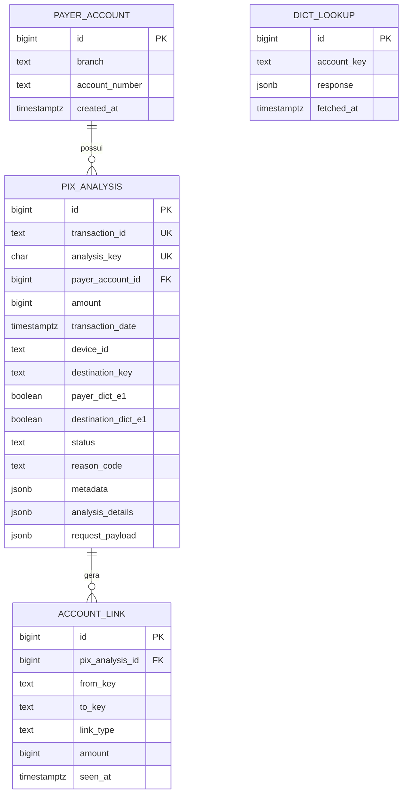
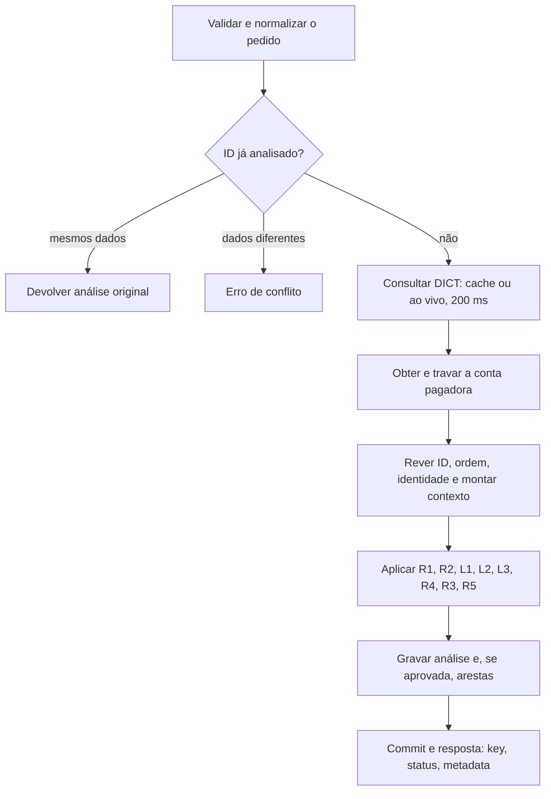
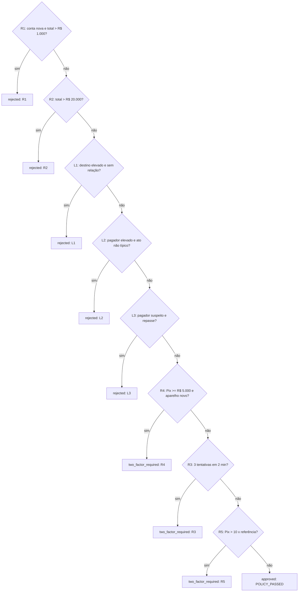

# Antifraude Pix

## Arquitetura e dados

**Versão 2 - como o motor foi implementado - política pix-v1.3 - 18/10/2026**

Uma API, um banco relacional, cinco regras base e um módulo de conta laranja. Este documento descreve o contrato, o modelo de dados, o histórico que o motor lê, o DICT simulado, os fluxos do POST e da decisão e as garantias de concorrência e idempotência, como estão no código. A política em si (por que cada regra existe) está em `docs/politica-antifraude-v2.md`; a validação, em `docs/testes-e-validacao-v2.md`.

### O que este desenho garante

- Toda solicitação recebe uma decisão com um único motivo, e as três decisões ficam gravadas.
- O histórico é lido por conta pagadora, e aprovação não é tratada como liquidação.
- Reenvios não contam duas vezes, e pedidos simultâneos da mesma conta não atravessam juntos um limite.
- A conta é classificada (DICT simulado e grafo local) antes de decidir o ato.
- O GET devolve a análise original, sem recalcular o passado.
- Falha técnica nunca vira decisão.

### Ordem de decisão

| Ordem | Condição | Decisão |
|---|---|---|
| 1 - R1 | Conta com menos de 7 dias; aprovado em 24h + Pix atual > R$ 1.000 | rejected |
| 2 - R2 | Aprovado em 24h + Pix atual > R$ 20.000 | rejected |
| 3 - L1 | Destino em suspeita elevada e sem relação anterior | rejected |
| 4 - L2 | Pagador em suspeita elevada e ato que não é gasto típico | rejected |
| 5 - L3 | Pagador em suspeita e repasse aparente | rejected |
| 6 - R4 | Pix >= R$ 5.000 e aparelho sem 24h desde a primeira aprovação | two_factor_required |
| 7 - R3 | Terceira solicitação distinta, ou posterior, em 2 minutos | two_factor_required |
| 8 - R5 | Pix > 10 x maior(média aprovada, R$ 500), com aprovação anterior | two_factor_required |
| Padrão | Nenhuma condição acima | approved |

<!-- page -->

# 1. Contrato da API

Duas rotas, nos nomes exatos do desafio, ambas com o cabeçalho `INTERNAL-TOKEN` (403 sem ele): `POST /pix/transaction` analisa e grava; `GET /pix/transaction/{id}` devolve a análise gravada pelo `id` do cliente. O corpo de entrada é o do desafio (`id`, `amount` em centavos, `transaction_date` com fuso, `source_account`, `destination_account`, `source`), validado por `src/schemas/post_pix_transaction.json` com `additionalProperties: false`; `geolocation` é opcional.

```json
{
  "key": "b3f1c2e0-7d4a-4c1e-9a52-1f0e6c9d2a77",
  "status": "rejected",
  "metadata": {
    "policy_version": "pix-v1.3",
    "reason": {
      "code": "NEW_ACCOUNT_LIMIT_EXCEEDED",
      "description": "Limite de conta nova excedido.",
      "observed_amount": 120000,
      "limit_amount": 100000
    }
  }
}
```

A resposta tem só os três campos pedidos. O `key` é o UUID público da análise; o id interno do banco nunca sai. Valores em centavos.

### Respostas HTTP

| Situação | Resposta | Código |
|---|---|---|
| Pix novo analisado | 201 | - |
| Reenvio equivalente do mesmo id | 200 | - |
| Mesmo id com conteúdo diferente | 409 | QIT003004 |
| Corpo fora do formato, campo a mais, amount não inteiro, texto inválido | 400 | QIT000001 |
| Sem INTERNAL-TOKEN | 403 | QIT000002 |
| Data inexistente ou fora do intervalo suportado | 422 | QIT003001 |
| Conta aberta depois do Pix | 422 | QIT003002 |
| Pix anterior ao último da conta | 422 | QIT003006 |
| Titular ou abertura diferente do histórico da conta | 422 | QIT003007 |
| Origem e destino são a mesma conta | 422 | QIT003008 |
| GET de id inexistente | 404 | QIT003003 |
| Conta travada por outro pedido além de 5 s | 503 | QIT003005 |
| Erro inesperado | 500, nunca uma decisão | QIT000500 |

400 significa "o pedido não pôde ser lido"; 422, "foi lido, mas os dados não podem existir". Nenhum erro de entrada consome limite, conta como tentativa ou cria familiaridade.

### Idempotência

O `id` do cliente é a chave. A comparação de reenvio é entre estruturas normalizadas (`src/utils/payload_normalizer.py`): ordem das chaves ignorada, as três datas comparadas como instantes UTC, documentos só pelos dígitos. Todo o resto é exato, inclusive canal, IP e geolocalização. Equivalente devolve a análise original (200), sem reavaliar nem contar de novo; diferente responde 409, sem alterar nada. `UNIQUE(transaction_id)` é a garantia final.

<!-- page -->

# 2. Modelo de dados

Quatro tabelas no PostgreSQL (`database/database.sql`). Não há cadastro de clientes, saldo nem ledger. Nenhuma tabela de histórico recebe UPDATE: o que muda no mundo vira uma linha nova, e "primeira vez", "total" e "contrapartes" saem de MIN, SUM e COUNT por consulta.

<!-- diagram:model -->



### As tabelas

| Tabela | Conteúdo | Observação |
|---|---|---|
| payer_account | A conta pagadora: agência e conta, UNIQUE | Âncora da trava; nasce na primeira análise, não é onboarding |
| pix_analysis | Uma linha por Pix: o pedido e a decisão juntos, gravados uma vez | Colunas para o que as regras consultam; corpo completo em request_payload; retrato da decisão em analysis_details |
| account_link | Arestas do grafo: pix (pagador para destino, com valor), device (conta e aparelho) e document (conta e titular) | Só para Pix aprovados, no mesmo commit da análise; seen_at é a transaction_date |
| dict_lookup | Uma linha por consulta ao DICT que respondeu | Cache append-only: vale a mais recente dentro da validade |

### Colunas de pix_analysis que as regras usam

| Campo | Tipo | Finalidade |
|---|---|---|
| transaction_id | TEXT, UNIQUE | id do POST; não exige UUID |
| analysis_key | UUID, UNIQUE | o key público da resposta |
| payer_account_id | BIGINT, FK | conta responsável pelos limites |
| amount | BIGINT, CHECK > 0 | valor em centavos, sem ponto flutuante |
| transaction_date | TIMESTAMPTZ | referência de todas as regras |
| source_opening_date | TIMESTAMPTZ | idade do pagador (R1, E2, E5) |
| device_id | TEXT | aparelho (R4 e grafo) |
| destination_key | TEXT | conta de destino, ispb:agência:conta |
| payer_document, destination_document | TEXT, só dígitos | titulares (E3, E5, relação anterior) |
| destination_opening_date | TIMESTAMPTZ | idade do destino (ato e E5) |
| payer_dict_e1/e4, destination_dict_e1/e4 | BOOLEAN | o que o DICT disse naquele Pix; NULL é desconhecido |
| status, reason_code | TEXT, CHECK | os três resultados e os nove códigos de motivo |
| policy_version, metadata | TEXT, JSONB | versão e explicação devolvidas no POST e no GET |

**Identidade da conta.** O payload só informa o ISPB do destino. A conta pagadora é sempre desta instituição, identificada pela variável `INSTITUTION_ISPB` (fictícia, 99999999); a chave `ispb:agência:conta` reconhece a mesma conta como pagadora e como destino. CPF/CNPJ nunca substitui a identidade da conta, e titular ou abertura divergentes do histórico são recusados (422).

**Índices:** `(payer_account_id, transaction_date)` para as janelas; parcial `(payer_account_id, device_id, transaction_date) WHERE status = 'approved'` para a primeira aprovação do aparelho; `(destination_key, transaction_date)` e `(payer_account_id, destination_document, transaction_date)` para o módulo; `account_link (to_key, link_type, seen_at)` e `(from_key, link_type, seen_at)` para seguir o dinheiro nos dois sentidos.

<!-- page -->

# 3. Histórico que o motor lê

Uma única camada de repositório monta o contexto, depois da trava da conta. O motor de regras recebe valores prontos e não executa SQL. Nenhum indicador inclui o Pix atual.

| Indicador | Como obter | Uso |
|---|---|---|
| approved_amount_24h | SUM dos approved da conta na janela de 24h | R1 e R2 |
| attempts_2m | COUNT das análises da conta em 2 min, qualquer status | R3 |
| first_device_approved_at | MIN(transaction_date) dos approved da conta no aparelho | R4 |
| approved_total e count | SUM e COUNT de todos os approved da conta até t | R5 |
| first_approval_to_destination | MIN(transaction_date) dos approved para o titular | ato e L1 |
| received e sent | SUM das arestas pix aprovadas em 1h, 24h e 30d | E2, E5, repasse |
| holders e estreantes | titulares distintos que enviaram na janela | E3 e E5 |
| counterparties | contas distintas com Pix aprovado em 30 dias | trava de E2 |
| shared_device | aparelho aprovado em comum com conta que tinha E1 | E2 |

### Convenção de janela

Para o Pix no instante `t`, o histórico usa datas em `(t - janela, t]`: uma linha exatamente em `t - janela` não conta, e uma já gravada com data igual a `t` conta. Só Pix `approved` contam como "recebido" ou "enviado".

```text
projected_amount_24h = approved_amount_24h + amount
projected_attempts_2m = attempts_2m + 1
account_is_new       = t - source_opening_date < 7 dias
device_is_known      = primeira aprovação existe
                       e t - primeira aprovação >= 24 horas
r5_reference_total   = max(approved_total, 50000 x approved_count)
r5_two_factor        = approved_count > 0
                       e amount x approved_count > 10 x r5_reference_total
```

Idades e esperas são calculadas como diferença entre datas, para não estourar o limite técnico de datas próximas do ano 1 ou 9999. A `transaction_date` precisa comportar a maior janela retrospectiva (30 dias); fora disso, 422.

<!-- page -->

# 4. DICT simulado e cache

O DICT é um Mockserver no docker compose, com respostas em `mocks/dict_expectations.json` (por padrão, nenhuma conta marcada). Ele segue, de forma simplificada, a estrutura da seção Antifraude da [API do DICT](https://www.bcb.gov.br/content/estabilidadefinanceira/pix/API-DICT.html); não é uma reprodução oficial. A extensão `EvidenceSince`, própria do mock, pode informar a data de início de E1 e E4.

| Tema | Decisão | Por quê |
|---|---|---|
| E1 e E4 | E1: MuleAccounts.d90 ou ScammerAccounts.d90 >= 1, ou DistinctFraudReporters.d90 >= 2. E4: OpenReports >= 2 | O motor só lê esses contadores |
| Prazo | 200 ms para o conjunto das consultas, antes da trava | A trava nunca espera a rede |
| Falhas | Timeout, erro de rede, 429, status diferente de 200 e corpo fora do formato viram desconhecido | Falha técnica nunca vira decisão |
| Pagador | Cache de 5 minutos desde a consulta, sem renovar na leitura; após expirar, consulta de novo | Muda pouco, e o atraso de uma marcação nova fica limitado a 5 min |
| Destino | Sempre ao vivo; o cache de 1 h só o socorre se o DICT falhar | Uma marcação nova vale no Pix seguinte |
| Paralelismo | Pagador e destino, quando os dois precisam, ao mesmo tempo | Um único limite de tempo |
| Datas | EvidenceSince sem fuso ou posterior ao Pix torna a resposta indisponível | Nunca inventar o início de uma evidência |

A consulta acontece fora da transação do banco: a leitura do cache é encerrada antes da espera HTTP, e a gravação das respostas é uma transação curta própria. Uma resposta que falhou nunca entra no cache. Em produção, o banco já consulta o DICT para fazer um Pix por chave; os contadores antifraude podem vir na mesma resposta.

<!-- page -->

# 5. Fluxo do POST

O retorno de negócio só sai depois que a análise está gravada. Rejeição antifraude é resultado persistido; erro de entrada, conflito e falha técnica são caminhos diferentes.

<!-- diagram:post -->



### Responsabilidades em cada passo

- **Entrada:** schema, texto válido, datas existentes, abertura anterior ao Pix e contas diferentes, antes de qualquer consulta.
- **Reenvio:** comparar o pedido normalizado; mesmo id com dados diferentes nunca sobrescreve a análise original.
- **DICT antes da trava:** a chamada externa acontece fora da transação.
- **Trava e releitura:** depois de travar a conta, procurar o id de novo, recusar pedido retroativo e identidade divergente, e ler histórico e grafo numa única camada.
- **Decisão:** função pura, sem consultas, que devolve o primeiro resultado aplicável.
- **Gravação:** análise e, se aprovada, as arestas na mesma unidade atômica. Se falhar, desfaz tudo e não responde sucesso.

<!-- page -->

# 6. Fluxo da decisão

Uma ordem fixa produz uma explicação previsível. Todas as condições leem o mesmo contexto e a mesma versão de parâmetros. Rejeição vem antes de 2FA, e o módulo de laranja nunca pede 2FA.

<!-- diagram:decision -->



<!-- page -->

### Exemplos de motivo

Repasse de conta laranja (L2): o motivo traz o estado da conta, as evidências, o ato e os números da hora, nunca documento nem a identidade de contas marcadas.

```json
"reason": {
  "code": "MULE_PAYER",
  "account": "payer",
  "account_state": "suspeita_elevada",
  "evidences": ["E1"],
  "act": "repasse_aparente",
  "incoming_amount_1h": 500000,
  "projected_outgoing_amount_1h": 400000,
  "minimum_incoming_amount": 100000,
  "threshold_percent": 50
}
```

Desvio da média (R5): a soma e a quantidade explicam a média exata, sem arredondar.

```json
"reason": {
  "code": "AMOUNT_ABOVE_ACCOUNT_AVERAGE",
  "observed_amount": 1500000,
  "historical_total_amount": 60100,
  "historical_transaction_count": 2,
  "average_multiplier": 10,
  "reference_floor_amount": 50000
}
```

O retrato completo da classificação (estado e evidências das duas contas, ato, relação anterior, situação do DICT e valores observados) fica em `analysis_details`, só para auditoria.

# 7. Concorrência e persistência

### Trava por conta, sem trava global

Transação em READ COMMITTED. A linha de `payer_account` é criada com INSERT ... ON CONFLICT DO NOTHING e travada com `SELECT ... FOR NO KEY UPDATE` antes de ler o histórico, até o commit. Espera acima de 5 segundos devolve 503, sem gravar nada.

```text
Conta antiga; aparelho conhecido; média de R$ 2.000; nada aprovado hoje
A solicita R$ 12.000 -> obtém a trava -> aprova -> commit
B solicita R$ 12.000 -> aguarda a mesma conta
B lê o histórico após A -> total R$ 24.000 -> rejeita por R2
```

Sem a trava, os dois leriam zero e aprovariam. A mesma proteção faz a terceira tentativa enxergar as anteriores (R3) e cada repasse enxergar os anteriores (L3). Contas diferentes seguem independentes.

**Por que FOR NO KEY UPDATE:** o INSERT em pix_analysis tem chave estrangeira para a conta e pede FOR KEY SHARE, que conflita com FOR UPDATE e causava deadlock entre pedidos concorrentes. FOR NO KEY UPDATE exclui as outras análises da mesma conta e convive com a checagem da chave estrangeira.

**Limite conhecido:** pagadores diferentes enviando ao mesmo destino ao mesmo tempo não se enxergam, porque a trava é por pagador. Entradas concorrentes podem ficar fora do contexto; isso é aceito no protótipo.

### Idempotência e conflitos

| Situação | Comportamento implementado |
|---|---|
| ID existente e conteúdo equivalente | 200 com a análise original; não reavalia nem conta de novo |
| ID existente e conteúdo diferente | 409; não altera histórico nem contadores |
| Mesmo ID concorrente na mesma conta | O segundo espera a trava, procura o id de novo e devolve a original |
| Mesmo ID concorrente em contas diferentes | UNIQUE decide; o perdedor desfaz tudo, relê e trata o vencedor como reenvio |
| Falha antes de concluir a gravação | Rollback; não responde sucesso de análise |
| Commit concluído e resposta perdida | Reenvio ou GET recuperam a análise original |

O GET devolve o envelope gravado, sem executar regras de novo e sem depender da versão atual da política. Nenhum contador fica em memória: o banco é a única fonte de estado, e qualquer réplica da API atende qualquer pedido.

<!-- page -->

# 8. Camadas e execução

O código segue o Base Service do bootcamp: a seta de dependência vai sempre do resource para o banco.

| Camada | Onde | Responsabilidade |
|---|---|---|
| Resource | src/resources/pix_transaction.py | Valida o schema, chama o controller e escolhe o status HTTP de sucesso |
| Controller | src/controllers/ | Ordem dos passos, trava, releitura do id, commit; o DictController decide cache ou ao vivo |
| Regras | src/rules/ | Política pura: parâmetros, R1 a R5, classificação, ato, L1 a L3; sem banco nem I/O |
| Repository | src/repositories/ | Todas as consultas: contexto, grafo, cache e gravação |
| Connector | src/connectors/dict_connector.py | HTTP com o DICT simulado, com prazo |
| Erros e DTO | src/errors/, src/dtos/ | Um código por recusa; a resposta pública de três campos |

### Como rodar

```text
docker compose up --build -d --wait
docker compose --profile test run --build --rm tests
docker compose --profile test run --rm --no-deps tests python -m flake8 .
```

Não é preciso Python no host nem `.env`. A API atende na porta 3000, com `INTERNAL-TOKEN: default_token`. O compose também publica o Postgres (5432) e o mock (1080) no host; se essas portas estiverem ocupadas, troque `DB_PORT` e `MOCKSERVER_PORT` num `.env`, como em `.env.example`. Bancos criados antes da v1.2 precisam da migração `database/migrations/001_account_average_reason.sql`, descrita no README.

Este documento descreve o recorte implementado do protótipo. Ele não comprova eficácia contra fraude real: os testes verificam que o código segue as regras descritas.
