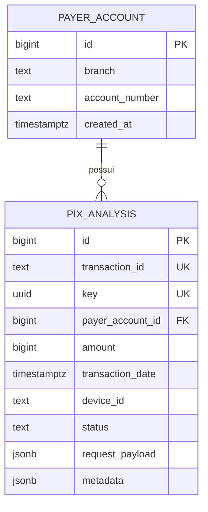
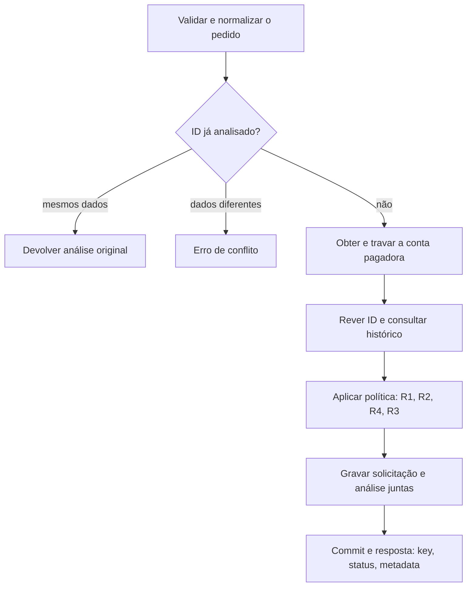
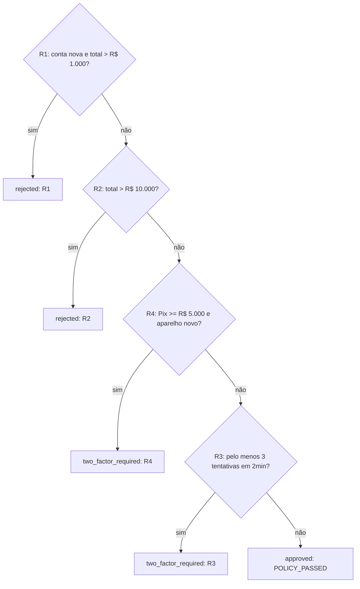

# Antifraude Pix

## Dados e fluxo de análise

**Proposta técnica inicial - versão 0.1 - 17/10/2026**

Uma API, um banco relacional e quatro regras determinísticas. Este desenho traduz a política acordada em dados, consultas e passos de processamento. Ainda não é a aplicação implementada.

### O que esta proposta resolve

- Preservar a solicitação e sua decisão com um motivo determinante.
- Consultar histórico por conta pagadora, sem transformar aprovação em confirmação de liquidação.
- Evitar dupla contagem de reenvios e decisões inconsistentes em pedidos simultâneos.
- Recuperar a análise original pelo GET, sem recalcular o passado.

### Política que orienta o desenho

| Ordem | Condição | Decisão |
|---|---|---|
| 1 - R1 | Conta com menos de 7 dias; aprovado em 24h + Pix atual > R$ 1.000 | rejected |
| 2 - R2 | Aprovado em 24h + Pix atual > R$ 10.000 | rejected |
| 3 - R4 | Pix >= R$ 5.000 e aparelho sem 24h desde a primeira aprovação | two_factor_required |
| 4 - R3 | Terceira tentativa distinta, ou posterior, em 2 minutos | two_factor_required |
| Padrão | Nenhuma condição acima | approved |

As janelas, a idade da conta e a espera do aparelho usam `transaction_date`. O motor informa apenas o motivo determinante. O tempo de execução não será critério de avaliação, conforme esclarecimento do usuário; não há SLA numérico inventado.

### Fronteira da proposta

O contrato dos PDFs é mantido. A integração com o Base Service oficial será conferida quando ele estiver disponível. As escolhas técnicas marcadas como **propostas** não alteram silenciosamente as regras de negócio.

<!-- page -->

# 1. Modelo de dados mínimo

Proposta: duas tabelas no PostgreSQL. Não há cadastro de clientes, saldo, ledger financeiro ou integração externa na decisão.

<!-- diagram:model -->



### payer_account: identidade e coordenação

| Campo | Tipo proposto | Finalidade |
|---|---|---|
| id | BIGINT, chave primária | Referência interna da conta |
| branch | TEXT | Agência; preservar zeros iniciais |
| account_number | TEXT | Conta; preservar zeros e dígito |
| created_at | TIMESTAMPTZ | Primeiro registro técnico no serviço |

Restrição proposta: `UNIQUE(branch, account_number)`. A linha é criada automaticamente ao analisar uma conta; isso não é um endpoint de onboarding. Ela também permite coordenar pedidos da mesma conta dentro da transação do banco.

### Premissa que precisa ser confirmada

**Uma instituição de origem por instância/base do protótipo.** O payload informa ISPB apenas do destino. Agência e conta não identificam globalmente contas de bancos diferentes. Com múltiplas origens, seria necessário contexto confiável da instituição, ainda ausente do contrato. Não usar CPF/CNPJ como substituto da identidade da conta.

<!-- page -->

# 2. Solicitação e análise na mesma linha

`pix_analysis` guarda um pedido e sua decisão final. Como não existe ciclo de reanálise ou conclusão de 2FA no contrato, separar duas tabelas em uma relação estritamente 1:1 acrescentaria complexidade sem uso atual.

| Campo | Tipo proposto | Finalidade |
|---|---|---|
| id | BIGINT, chave primária | Identificador interno; nunca substitui o ID de entrada |
| transaction_id | TEXT, UNIQUE | `id` recebido no POST; não exigir UUID |
| key | UUID, UNIQUE | Identificador público da análise |
| payer_account_id | BIGINT, FK | Conta responsável pelos limites |
| amount | BIGINT, CHECK > 0 | Valor em centavos, sem ponto flutuante |
| transaction_date | TIMESTAMPTZ | Instante do evento usado nas regras |
| received_at | TIMESTAMPTZ | Instante em que a API recebeu o pedido |
| analyzed_at | TIMESTAMPTZ | Instante do processamento da decisão |
| source_opening_date | TIMESTAMPTZ | Abertura informada no pedido; usada em R1 |
| device_id | TEXT | Aparelho informado; usado em R4 |
| status | TEXT, CHECK | Um dos três resultados do contrato |
| reason_code | TEXT | Único motivo determinante da decisão |
| policy_version | TEXT | Versão dos parâmetros e da precedência |
| request_payload | JSONB | Corpo completo recebido, sem cabeçalhos ou token |
| metadata | JSONB | Explicação persistida devolvida no POST e no GET |

### Colunas para consultar; JSON para preservar

Documento do pagador, destino, IP, canal e localização opcional permanecem no payload. Os campos usados pelas quatro regras têm colunas próprias. Assim, não é necessário criar modelos de todas as entidades recebidas nem indexar dados sem uso atual.

`status`, `reason_code`, `policy_version` e `metadata` são preenchidos na gravação final. Aprovações, rejeições e pedidos de 2FA são persistidos; falha de gravação não pode produzir resposta de sucesso.

### Restrições e índices iniciais

- UNIQUE de `transaction_id` e `key`; chave estrangeira para a conta pagadora.
- Índice `(payer_account_id, transaction_date)` para janelas históricas.
- Índice parcial `(payer_account_id, device_id, transaction_date)` onde `status = 'approved'`, para a primeira aprovação do aparelho.

<!-- page -->

# 3. Histórico que o motor precisa

O repositório entrega três indicadores e a data de abertura. O motor de regras recebe valores prontos e não executa SQL. Não é necessária uma tabela de dispositivos: a primeira aprovação é obtida do próprio histórico.

| Indicador | Como obter | Uso |
|---|---|---|
| approved_amount_24h | SUM(amount) dos approved da conta na janela de 24h | R1 e R2 |
| attempts_2m | COUNT de análises da conta na janela de 2min, qualquer status | R3 |
| first_device_approved_at | MIN(transaction_date) dos approved anteriores da conta/aparelho | R4 |

### Convenção de janela proposta

Para a solicitação atual no instante `t`, usar histórico já confirmado no banco com datas em `(t - janela, t]`. Excluir o pedido atual do histórico e acrescentá-lo uma única vez ao total e à contagem. Datas iguais a `t` podem ser incluídas se o pedido anterior já foi concluído; não usar linhas futuras ou ainda não confirmadas.

```text
projected_amount_24h = approved_amount_24h + current.amount
projected_attempts_2m = attempts_2m + 1
account_is_new = t < source_opening_date + 7 dias
device_is_known = primeira aprovação existe
                  e t >= primeira aprovação + 24 horas
```

R1 rejeita apenas acima de 100.000 centavos; R2, acima de 1.000.000. R4 atua a partir de 500.000 centavos. Exatamente sete dias encerra R1; exatamente 24 horas desde a primeira aprovação encerra a restrição de novidade do aparelho. Aprovações posteriores não reiniciam essa espera.

### Conhecido não significa seguro

O aparelho pertence ao contexto da conta pagadora. Só `approved` inicia a espera. `two_factor_required` não significa 2FA concluído. Como não existe retorno dessa confirmação, um aparelho pode continuar solicitando 2FA em pedidos elevados. Não criar uma aprovação automática nem outra rota para contornar essa limitação.

### Sem cálculos que não alteram a decisão

Não calcular reputação do destinatário, média de saldo, média de valores ou deslocamento geográfico nesta versão. Não são usados nas quatro regras; os dados recebidos continuam preservados.

<!-- page -->

# 4. Fluxo do POST

O retorno de negócio só sai após a análise ser gravada. Rejeição antifraude é resultado persistido; erro de entrada, conflito e falha técnica são caminhos diferentes.

<!-- diagram:post -->



### Responsabilidades em cada passo

- **Entrada:** validar campos e coerência antes de contar tentativas. Conta aberta depois do evento é erro de entrada.
- **Reenvio:** comparar o pedido normalizado; mesmo ID e dados diferentes não sobrescrevem a análise original.
- **Contexto:** após coordenar a conta, ler limites, frequência e primeira aprovação do aparelho.
- **Decisão:** uma função pura escolhe o primeiro resultado aplicável, sem novas consultas por regra.
- **Gravação:** incluir o corpo original e a decisão na mesma unidade atômica. Se falhar, desfazer tudo.

A verificação do ID é repetida depois da trava para capturar um reenvio concluído enquanto esta requisição aguardava. UNIQUE no banco continua sendo a garantia final, inclusive para IDs reutilizados entre contas diferentes.

<!-- page -->

# 5. Fluxo da decisão

Uma ordem fixa produz uma explicação previsível. As condições consultam o mesmo contexto histórico e a mesma versão de parâmetros.

<!-- diagram:decision -->



### Exemplo de resposta proposta

```json
{
  "key": "b3f1c2e0-7d4a-4c1e-9a52-1f0e6c9d2a77",
  "status": "rejected",
  "metadata": {
    "policy_version": "pix-v1",
    "reason": {
      "code": "NEW_ACCOUNT_LIMIT_EXCEEDED",
      "description": "Teto de conta nova excedido.",
      "observed_amount": 120000,
      "limit_amount": 100000
    }
  }
}
```

Valores da explicação também estão em centavos. O observado é o acumulado projetado incluindo o pedido atual. O formato interno de metadata e os nomes dos códigos são propostas; o contrato externo de três campos é preservado.

O retorno informa apenas o motivo determinante. Uma aprovação significa ausência de condição de intervenção, não probabilidade de segurança. Regras secundárias não aparecem como uma lista de alertas.

<!-- page -->

# 6. Persistência, reenvio e GET

### Coordenação por conta, sem trava global

Proposta: transação de banco em READ COMMITTED. Criar a linha de `payer_account` de forma segura diante de concorrência e executar `SELECT ... FOR UPDATE` nessa linha antes de consultar o histórico que determina a decisão. Manter a trava até o commit.

```text
Conta antiga; aparelho conhecido; acumulado inicial zero
A solicita R$ 6.000 -> obtém a trava -> aprova -> commit
B solicita R$ 6.000 -> aguarda a mesma conta
B lê o histórico após A -> total R$ 12.000 -> rejeita por R2
```

Sem essa coordenação, ambos poderiam ler zero e aprovar. A mesma proteção permite que a terceira tentativa observe as duas anteriores. Contas diferentes seguem independentes. A tabela de conta serve como âncora técnica; não representa cadastro bancário nem saldo.

### Idempotência e conflitos

| Situação | Comportamento proposto |
|---|---|
| ID existente e conteúdo equivalente | Retornar key, status e metadata originais |
| ID existente e conteúdo diferente | Erro de conflito; não alterar histórico nem contadores |
| Mesmo ID concorrente | UNIQUE decide; após rollback, reler e comparar |
| Falha antes de concluir a gravação | Rollback; não responder sucesso de análise |
| Commit concluído e resposta perdida | Reenvio ou GET recuperam a análise original |

Comparar estruturas normalizadas, não o texto JSON bruto: ordem das chaves não diferencia pedidos. Normalizar datas para UTC e documentos de maneira consistente; preservar identificadores textuais e zeros iniciais. Sem arredondar valor. A equivalência cobre todo o payload, não apenas valor e destinatário.

### GET /pix/transaction/{id}

Consultar `transaction_id` e devolver o mesmo envelope de três campos gravado. Não executar novamente as regras nem atualizar a idade do aparelho. ID não encontrado gera erro de consulta; não há decisão antifraude a devolver. Os códigos HTTP e o envelope de erros seguirão o contrato e as convenções do Base Service, a conferir.

Não armazenar contador de 24h ou estado de confiança em memória nesta versão. Consultar o banco reduz estado duplicado e evita divergências entre processos.

<!-- page -->

# 7. Validação e sequência de implementação

As regras foram acordadas; o desenho de armazenamento e fluxo é proposta inicial. As convenções abaixo precisam de revisão antes de serem incorporadas ao comportamento definitivo.

### Convenções técnicas propostas

| Tema | Proposta e consequência |
|---|---|
| Origem | Uma instituição por instância; confirmar a identidade da conta antes de implementar |
| Bordas temporais | Histórico em (t - janela, t]; pedido atual entra uma única vez |
| Fora de ordem | Para o MVP, propor rejeição de entrada retroativa por conta, sem reanalisar decisões anteriores; essa restrição adicional precisa ser validada |
| Data futura | Validar contra um relógio de referência; tolerância ainda em aberto. Testes históricos usam relógio controlado |
| Abertura inconsistente | Transação anterior à abertura é erro; alterações de abertura/titular entre pedidos da mesma conta precisam de tratamento explícito |
| Falhas técnicas | Não transformar indisponibilidade em approved, rejected ou two_factor_required |

### Aceitação antes de considerar o desenho pronto

- Preservar os 21 cenários da política de negócio e seus motivos determinantes.
- Testar valores exatamente nos tetos e datas exatamente nas bordas de 2min, 24h e 7 dias.
- Demonstrar que duas solicitações simultâneas não atravessam juntas o limite da conta.
- Verificar reenvio idêntico, conflito de ID, rollback e GET após mudança de política.
- Verificar aprovação pequena, espera inicial de 24h e ausência de reinício após nova aprovação.

### Implementar em quatro entregas pequenas

1. Validar o Base Service e fechar as convenções pendentes.
2. Criar schema, POST/GET, persistência atômica e idempotência.
3. Implementar contexto histórico e motor puro; ligar os cenários às regras.
4. Completar testes de integração/concorrência e README com decisões e limitações.

### Fontes e rastreabilidade

- Política acordada: `docs/regras-de-negocio.md`, commit `744b799` do repositório `LuigiNakata10/antifraude-pix-teste`.
- `Desafio Antifraude Pix.pdf`: seções 3 e 4, contrato e escopo; seções 6 e 7, documentação e avaliação.
- `Hackathon Antifraude Pix.pdf`: slides 14 a 25, contexto, contrato, entregas e critérios.

Este documento não comprova eficácia contra fraude real nem testes executados. Ele fornece uma proposta revisável para implementar fielmente o recorte do protótipo, sem acrescentar serviços ou funcionalidades sem necessidade.
