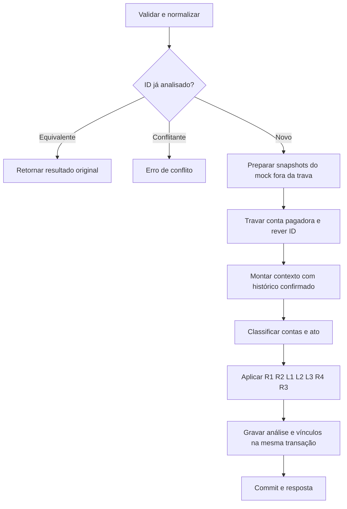

# Motor Antifraude Pix — Guia de desenvolvimento v1.1

17/10/2026. Especificação documental do protótipo, ainda sem implementação ou testes executados.

## 1. Escopo e fontes

Uma API antifraude geral com quatro regras base e um módulo de possível uso de contas laranja. A demonstração apresenta como as regras se complementam. As decisões são `approved`, `rejected` e `two_factor_required`, com um único motivo determinante.

Esta revisão acrescenta arquivos v1.1 sem alterar os documentos v1. A numeração indica refinamento da proposta, sem alteração das rotas ou dos três campos externos exigidos pelo desafio.

| Documento | Papel nesta versão |
|---|---|
| [Política base v1](regras-de-negocio-v1.md) | R1–R4, definições e cenários C01–C21 preservados |
| [Dados e fluxo v1](dados-e-fluxo-v1.md) | Proposta técnica base; suas convenções ainda pendentes não viram decisões automaticamente |
| [Módulo de contas laranja v1.1](modulo-contas-laranja-v1.1.md) | Evidências, estados, atos, L1–L3 e cenários revisados; prevalece sobre o módulo v1 |
| Este guia | Integração, contrato, modelo único e sequência de implementação; prevalece sobre o guia v1 |

Os PDFs originais continuam sendo as referências de contrato e avaliação. O PDF de dados e fluxo já publicado documenta a proposta base anterior, não a integração v1.1. O Base Service deve ser conferido antes de fixar convenções de erros e estrutura de código.

Tempo de execução não é critério de avaliação informado pelo usuário. Não impor SLA numérico nem otimizações antecipadas. Manter a decisão simples, com limites de espera para a fonte externa simulada.

## 2. Política integrada

Aplicar a primeira condição verdadeira nesta ordem:

| Ordem | Regra | Condição | Decisão / motivo |
|---|---|---|---|
| 1 | R1 | Pagador com menos de 7 dias; aprovado em 24h mais pedido atual acima de R$ 1.000 | `rejected` / `NEW_ACCOUNT_LIMIT_EXCEEDED` |
| 2 | R2 | Aprovado em 24h mais pedido atual acima de R$ 10.000 | `rejected` / `DAILY_LIMIT_EXCEEDED` |
| 3 | L1 | Destinatário em suspeita elevada, sem relação anterior estabelecida | `rejected` / `MULE_DESTINATION` |
| 4 | L2 | Pagador em suspeita elevada; ato diferente de gasto típico | `rejected` / `MULE_PAYER` |
| 5 | L3 | Pagador suspeito; repasse aparente | `rejected` / `SUSPECTED_MULE_FORWARDING` |
| 6 | R4 | Valor individual de pelo menos R$ 5.000 e aparelho sem 24h desde a primeira aprovação naquela conta | `two_factor_required` / `NEW_DEVICE_HIGH_AMOUNT` |
| 7 | R3 | Terceira tentativa distinta ou posterior da conta em 2 minutos | `two_factor_required` / `HIGH_FREQUENCY` |
| Padrão | — | Nenhuma condição de intervenção | `approved` / `POLICY_PASSED` |

R1/R2 usam somente valores previamente aprovados. R3 conta todos os resultados de pedidos válidos, sem contar reenvios. R4 usa a primeira aprovação e não reinicia a espera após novas aprovações. Exatamente R$ 1.000 e R$ 10.000 não excede os respectivos tetos. Exatamente 7 dias encerra R1; exatamente 24h desde a primeira aprovação torna o aparelho familiar.

As regras usam `transaction_date`. Entrada inválida não gera decisão antifraude, não conta e não cria familiaridade. O motor não executa o Pix, não confirma liquidação e não conclui 2FA.

No módulo, a classificação é elevada somente por **E1 ou E2 + E4**. Demais conjuntos positivos ficam em `suspeita`; sem evidência positiva, `nao`, com indisponibilidades registradas. A definição completa está no módulo v1.1 e não deve ser reimplementada como contagem genérica de sinais.

O ato segue a ordem **repasse aparente → gasto típico → outro**. A relação anterior é uma exceção de política, não prova de legitimidade; depende de datas de evidências conhecidas. L2 continua recusando também `outro`, com o custo de fricção descrito no módulo.

## 3. Contrato e retorno

- `POST /pix/transaction`: recebe o payload do desafio, analisa e persiste.
- `GET /pix/transaction/{id}`: consulta pelo ID recebido e retorna o resultado original.
- A resposta mantém somente `key`, `status` e `metadata` no nível superior.

```json
{
  "key": "b3f1c2e0-7d4a-4c1e-9a52-1f0e6c9d2a77",
  "status": "rejected",
  "metadata": {
    "policy_version": "pix-v1.1",
    "reason": {
      "code": "SUSPECTED_MULE_FORWARDING",
      "description": "Conta suspeita com repasse aparente no histórico observado.",
      "payer_state": "suspeita",
      "act": "repasse_aparente",
      "evidence_codes": ["E3"],
      "observed_incoming_amount_1h": 200000,
      "projected_outgoing_amount_1h": 160000,
      "minimum_incoming_amount": 100000,
      "forwarding_threshold_percent": 50
    }
  }
}
```

Valores monetários são inteiros em centavos. As evidências acima explicam somente a regra determinante; não listar todas as regras avaliadas. Dados de outras contas marcadas, CPF/CNPJ completo, IP e aparelho ficam fora da explicação pública.

Para `approved`, usar `POLICY_PASSED` e informar ausência de condição de intervenção, sem afirmar que o pagamento é seguro. O GET retorna exatamente a decisão persistida, mesmo que a política ou o mock mudem depois.

Idempotência compara o payload completo normalizado: ordem de chaves não importa; datas equivalentes são normalizadas para UTC; documentos são normalizados de forma consistente; identificadores e zeros iniciais são preservados. Não arredondar valores. Mesmo ID equivalente retorna a análise original; ID conflitante não sobrescreve nada.

Os códigos HTTP propostos continuam 201 para criação, 200 para reenvio equivalente, 409 para conflito, 400 para entrada inválida, 403 sem token e 404 para ID inexistente. Confirmar o envelope e os códigos com o Base Service. Falha de persistência gera erro técnico e rollback, nunca sucesso de análise.

## 4. Modelo único de dados

| Tabela | Campos e responsabilidade |
|---|---|
| `payer_account` | `id`, `branch`, `account_number`, `created_at`; identidade local e âncora de trava, com unicidade de agência/conta na instituição de origem configurada |
| `pix_analysis` | `transaction_id` único, `key` único, `payer_account_id`, `amount`, `transaction_date`, `source_opening_date`, `device_id`, `received_at`, `analyzed_at`, `status`, `reason_code`, `policy_version`, `request_payload`, `metadata` |
| Extensões de `pix_analysis` | `payer_document`, `destination_key`, `destination_document`, `destination_opening_date`, `analysis_details` |
| `account_link` | `from_key`, `to_key`, `link_type`, `first_seen`, `last_seen`, `total_amount`; projeção dos vínculos observados, atualizada atomicamente com a análise |
| `dict_lookup` | `document` único, `response`, `fetched_at`, `as_of`; cache da fonte normalizada por titular, coerente com o mock v1.1 |

`analysis_details` armazena estados, evidências, datas de início conhecidas ou desconhecidas, ato, relação e snapshots utilizados. Não é retornado integralmente pelo GET.

Não criar tabelas adicionais `account`, `pix_transaction` ou `rule_evaluation` a partir dos exemplos históricos. Não há cadastro, saldo, ledger, tabela de estado permanente ou banco de grafos dedicado.

**Fonte dos cálculos temporais:** consultar as linhas aprovadas de `pix_analysis`, filtradas por data. `account_link.total_amount` é um agregado histórico; `first_seen` e `last_seen` não permitem decompor esse valor em janelas de 1h, 24h ou 30 dias. Não usar o total vitalício filtrado por `last_seen` como se fosse soma da janela.

Arestas `pix` usam apenas aprovações; o aparelho pertence ao pagador, nunca ao destinatário. Vínculos de documento não propagam suspeita automaticamente. O grafo visual da apresentação pode ser gerado a partir do mesmo histórico, fora do caminho da decisão.

Índices iniciais:

- `(payer_account_id, transaction_date)` para limites e frequência.
- Parcial `(payer_account_id, device_id, transaction_date)` para aprovações do aparelho.
- `(destination_key, transaction_date)` para entradas observadas.
- `(payer_account_id, destination_document, transaction_date)` para relação anterior.
- Índices das chaves de `account_link` e unicidade de `dict_lookup.document`.

A identidade de conta é participante/agência/conta. O participante de origem é configuração única da instância, porque não existe no payload. Essa premissa restringe a visibilidade do grafo e deve aparecer na apresentação.

## 5. Fluxo integrado



Resource valida e traduz HTTP; controller coordena; repositórios consultam; connector obtém o mock; funções puras classificam e decidem; DTO produz o envelope. As regras não fazem SQL nem HTTP.

Usar transação READ COMMITTED e trava na linha da conta pagadora antes de ler os indicadores que decidem. Manter até o commit. Revalidar ID após a espera; unicidade no banco protege inclusive IDs concorrentes em contas diferentes. Após conflito de unicidade, reler e comparar depois do rollback.

A trava serializa saídas da mesma conta, incluindo limites e proporção projetada de repasse. Não serializa entradas de pagadores diferentes para um destinatário. O módulo pode observar apenas parte dessas entradas concorrentes, em quantidade não limitada a uma ou duas. Aceitar essa limitação no protótipo e documentá-la; não alegar visão global atômica do grafo.

Para E2, preparar fora da trava os snapshots das contrapartes candidatas do histórico. Depois da trava, reler o histórico: contraparte nova sem snapshot válido permanece desconhecida nessa análise, sem chamada de rede sob a trava. Essa limitação precisa aparecer na auditoria.

O mock não deve ficar dentro da transação de banco. Timeout e erro deixam a evidência externa desconhecida; um cache ainda válido pode ser usado. Validade de cache e timeout são configuração operacional, sem promessa de latência de produção. Para uma primeira implementação simples, usar uma validade única por titular; a escolha numérica deve ser documentada com o fixture de expiração.

## 6. Convenções que ainda precisam ser fechadas

Não confundir esta revisão do módulo com aprovação automática das pendências técnicas da proposta base:

- Confirmar bordas `(t − janela, t]` e política de pedidos fora de ordem.
- Definir tolerância de datas futuras e relógio controlado nos testes.
- Tratar mudança de titular ou data de abertura para uma identidade de conta existente.
- Confirmar códigos HTTP, normalização e demais convenções com o Base Service.

Conta aberta depois da data do evento continua sendo entrada inválida. Histórico futuro não pode ser usado. Não existe endpoint de conclusão de 2FA nem aprovação automática de um pedido anteriormente desafiado.

## 7. Verificação e critérios de aceite

| Conjunto | Verificação |
|---|---|
| Base C01–C21 | Preservar resultados e motivos em cenários sem evidência adicional do módulo |
| Classificação | E1 e E2+E4 elevam; E3+E5 não eleva; desconhecido não é positivo; expiração muda estado |
| Atos | Repasse prevalece na sobreposição com gasto típico; mínimo de entrada e limites nas bordas |
| Módulo P01–P20 | Usar a matriz corrigida do módulo v1.1, incluindo classificação e motivo |
| Contrato | POST, GET, entrada inválida, ID inexistente e token conforme Base Service |
| Persistência | Reenvio equivalente, conflito, rollback, análise original após mudança de política ou mock |
| Concorrência | Saídas da mesma conta veem aprovações anteriores; um ID é persistido uma única vez |
| Fonte externa | Timeout, erro, resposta malformada, cache válido/expirado, mudança temporal da marcação |
| Histórico parcial | Recebimentos ausentes não são inventados; recusas/2FA não alimentam entradas ou repasses |

Testes HTTP cobrem a integração. Testes das funções puras cobrem classificação e precedência, incluindo casos em que um estado incorreto produziria o mesmo status final. Não declarar eficácia contra fraude com base somente nesses testes de aderência à política.

Os cenários base não precisam manter o resultado se forem deliberadamente adicionadas evidências que acionem L1–L3. O teste de regressão preserva suas premissas, não desliga o módulo em produção.

## 8. Implementação e apresentação

1. Fechar as convenções pendentes e conferir o Base Service.
2. Implementar POST/GET, persistência, normalização e idempotência.
3. Implementar contexto e R1–R4 com seus cenários.
4. Implementar mock normalizado, contexto adicional e funções puras do módulo v1.1.
5. Integrar a ordem de decisão e executar os cenários de contraste, concorrência e falhas.
6. Documentar parâmetros, limitações e preparação da demo no README de execução.

Na demo, mostrar uma operação que passa pelas regras gerais mas é recusada por L2/L3; comparar com gasto típico permitido e arrecadação que não eleva estado por E3+E5. Usar conta pagadora antiga no exemplo principal para que R1 não esconda a contribuição do módulo.

O histórico precisa ser possível de construir pelas mesmas regras da API. Quando necessário, simular a marcação surgindo depois das operações anteriores, com fixtures temporais e cache coerentes. A apresentação deve chamar o cenário de simulado, salvo reconstrução de caso real com fonte identificada.

## 9. Riscos assumidos

- Marcação, histórico e recorrência não comprovam legitimidade ou fraude de uma operação.
- Relação anterior pode fazer parte do esquema; a data da identificação não é a data de início da fraude.
- L2 também bloqueia pagamentos legítimos classificados como `outro`.
- O critério de repasse pode atingir rateios legítimos; gasto em CNPJ antigo pode esconder fraude.
- E2+E4 não garante independência entre as fontes; esta combinação é uma política do protótipo.
- A visão parcial do histórico pode perder vínculos e repasses; valores aprovados não são saldo nem liquidação.
- Fonte indisponível reduz a cobertura; o resultado deve ser explicado pelas evidências efetivamente disponíveis.
- Uma conta conhecida e operações abaixo dos limiares podem continuar viabilizando fraude.

Não fazem parte desta revisão: IA/ML, score geral, verificação real de finalidade do pagamento, DICT real, conclusão de 2FA, recuperação de valores ou calibração automática. A fonte simulada oferece evidências para a política, não uma certificação de legitimidade.
